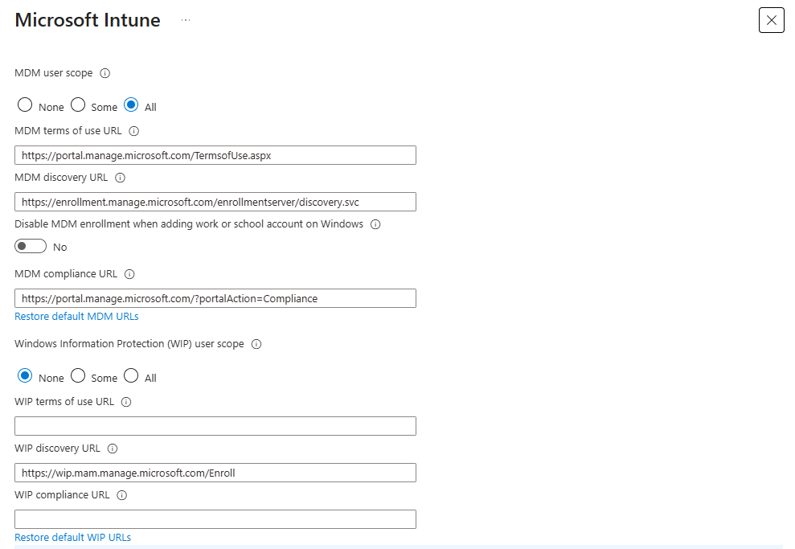

# Cloud Identity Management & Microsoft Intune MDM

## 🎯 Objective
Bridge on-premises infrastructure with modern cloud-native endpoint administration by provisioning a Microsoft 365 Business Premium tenant, configuring automated group-based licensing, and enforcing cloud security baselines via Microsoft Intune.

---

## 🛠️ Environment & Architecture
- **Cloud Identity & Tenant:** Microsoft 365 Business Premium Sandbox (`ApexTech99.onmicrosoft.com`)[cite: 3]
- **Identity & Access Management:** Microsoft Entra ID (Cloud Users, Security Groups, Global Administration)[cite: 1]
- **Endpoint Management Plane:** Microsoft Intune Admin Center (`intune.microsoft.com`)[cite: 1]
- **Managed Client Endpoint:** Windows 11 Pro (`WIN11-CLIENT01` - Enrolled via *Access work or school* with vTPM 2.0 hardware encryption)[cite: 5]

---

## 📋 Implementation Steps

### 1. Tenant Provisioning & Group-Based Licensing
- Activated a Microsoft 365 Business Premium trial tenant (`ApexTech99.onmicrosoft.com`)[cite: 3].
- Created a dedicated Entra ID Security Group named **`SG_M365_BusinessPremium`** in the Microsoft Entra admin center (`entra.microsoft.com`)[cite: 1].
- Configured **Group-Based Licensing** by assigning the M365 Business Premium product license directly to the security group, ensuring any user added to the group automatically inherits Exchange Online, Teams, OneDrive, and Intune entitlements.

### 2. Configuring Automatic MDM Enrollment
- Navigated to **Identity > Devices > Mobility (MDM and WIP)** in the Entra admin center.
- Set the **MDM user scope** to target users, enabling automatic registration when organizational accounts authenticate on client endpoints.

### 3. Client Onboarding & Intune Enrollment
- Logged into the Windows 11 client workstation (`WIN11-CLIENT01`) using local administrator privileges.
- Navigated to **Settings > Accounts > Access work or school** and connected the cloud administrative identity (`goodmans@ApexTech99.onmicrosoft.com`)[cite: 5].
- Verified successful MDM enrollment, establishing two-way telemetry and policy enforcement between the endpoint and the Intune administration plane.

### 4. Deploying Cloud Security & Compliance Policies
- Created a Windows 10/11 Compliance Policy (`WIN11-Security-Compliance`) in the Intune admin center.
- Enforced core hardware and system security baselines:
  - **Device Health:** Required Secure Boot to be enabled (leveraging KVM virtual TPM 2.0).
  - **System Security:** Required active Firewall protection and BitLocker drive encryption.
- Targeted the compliance policy to device groups for immediate posture evaluation.

---

## ✅ Verification & Testing

1. **Forcing Intune Check-in:**
   - Navigated to **Settings > Accounts > Access work or school > Info** on `WIN11-CLIENT01` and triggered a manual **Sync** to update the client's security telemetry.

2. **Validating Compliance in the Intune Portal:**
   - Opened **intune.microsoft.com > Devices > All devices**, selected `WIN11-CLIENT01`, and reviewed the device compliance dashboard to confirm a **Compliant** operational status[cite: 1].

---

## 📸 Lab Evidence

### 1. Entra ID Security Group (`SG_M365_BusinessPremium`)
Cloud security group provisioned for automated Microsoft 365 Business Premium group-based licensing.

### 2. Automatic MDM Enrollment Scope
Microsoft Intune MDM user scope configured in Entra ID to trigger automatic enrollment upon user sign-in.

### 3. Intune Device Inventory & Compliance Status
`WIN11-CLIENT01` enrolled under Microsoft Intune MDM management and verified as **Compliant** against the `WIN11-Security-Compliance` baseline.

### 4. Client-Side MDM Connection (`WIN11-CLIENT01`)
Endpoint verification in Windows Settings confirming connection to the `ApexTech99.onmicrosoft.com` tenant and active Apex Tech MDM management.

